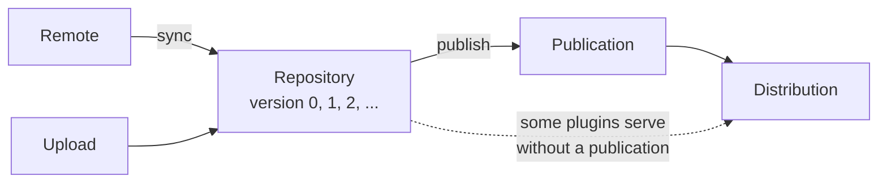

# Pulp

<br>
<br>
<Link to="toc" title="Table of Contents"/>

---
hideInToc: true
level: 2
---

# What is Pulp?

- Open source (GPLv2) repository manager from the Pulp Project, written in Python/Django
- No commercial edition, no EULA, no license key
- A small core (`pulpcore`) plus a plugin per content type: `file`, `deb`,
  `rpm`, `container`, `python`, `npm`, `maven`, `gem`, `ansible`, ...
- Everything is a REST API; there's no bundled web UI
- Driven with `pulp-cli`, `curl`, Ansible, or any OpenAPI client

These slides use pulpcore 3.123.1 (October 2026), with pulp-deb 3.11.1,
pulp-container 2.30.0, pulp-python 3.37.1 and pulp-npm 0.10.2.

---
hideInToc: true
level: 2
---

# Pulp's building blocks

Nexus has one object, a "repository", with a type: hosted, proxy or group.
Pulp splits that into separate objects you wire together:

| Object | What it is |
| --- | --- |
| Remote | Where to sync from, and how much to download (`immediate`, `on_demand`, `streamed`) |
| Repository | A set of content, **versioned**: every change makes a new repository version |
| Publication | Metadata generated for one repository version (apt `Release`, `PULP_MANIFEST`, ...) |
| Distribution | Serves a repository or publication at `/pulp/content/<base_path>/` |
| Content guard | Optional, controls who may download from a distribution |

---
hideInToc: true
level: 2
---

# How the objects fit together



---
layout: section
level: 2
---

# Pulp in a container

<br>
<br>
<Link to="toc" title="Table of Contents"/>

---
hideInToc: true
level: 2
---

# Create the settings file

`pulp/pulp` runs PostgreSQL, Redis, nginx, the API, content app and workers in one container.

```bash
mkdir -p pulp/settings/certs
cd pulp

# The image doesn't generate a SECRET_KEY: without one every API call is a 500
tee settings/settings.py > /dev/null <<EOF
# URL clients download from: written into redirects and index pages
CONTENT_ORIGIN='http://localhost:8080'
SECRET_KEY='$(openssl rand -base64 48 | tr -d '\n')'
# Container registry token auth: the image makes the keys, but not these settings
TOKEN_SERVER='http://localhost:8080/token/'
TOKEN_SIGNATURE_ALGORITHM='ES256'
PUBLIC_KEY_PATH='/etc/pulp/certs/token_public_key.pem'
PRIVATE_KEY_PATH='/etc/pulp/certs/token_private_key.pem'
# Base URL pulp_python advertises (defaults to https://<container id>)
PYPI_API_HOSTNAME='http://localhost:8080'
# Pulp posts anonymous usage analytics unless this is off
ANALYTICS=False
EOF
```

---
hideInToc: true
level: 2
---

# Docker install

```bash
mkdir -p pulp_storage pgsql containers

docker container run --detach \
  --publish 8080:80 \
  --name pulp \
  --volume "$(pwd)/settings":/etc/pulp \
  --volume "$(pwd)/pulp_storage":/var/lib/pulp \
  --volume "$(pwd)/pgsql":/var/lib/pgsql \
  --volume "$(pwd)/containers":/var/lib/containers \
  docker.io/pulp/pulp:3.123.1
```

```bash
# Wait until the API answers
until curl --silent --fail http://localhost:8080/pulp/api/v3/status/ > /dev/null; do
  sleep 5
done
curl --silent http://localhost:8080/pulp/api/v3/status/ \
  | jq -r '.versions[] | "\(.component) \(.version)"'
```

---
hideInToc: true
level: 2
---

# Apple container install (macOS)

```bash
container system start   # once per boot

# Bind-mounted host directories can't be chown'd inside the VM, so
# PostgreSQL won't start on them. Use named volumes for the data.
container volume create pulp-storage
container volume create pulp-pgsql
container volume create pulp-containers

# The default 1 GB of memory is too small for PostgreSQL + Pulp
container run --detach \
  --name pulp \
  --cpus 4 --memory 4g \
  --publish 8080:80 \
  --volume "$(pwd)/settings":/etc/pulp \
  --volume pulp-storage:/var/lib/pulp \
  --volume pulp-pgsql:/var/lib/pgsql \
  --volume pulp-containers:/var/lib/containers \
  docker.io/pulp/pulp:3.123.1
```

Use `container exec` wherever the following slides say `docker exec`.

---
hideInToc: true
level: 2
---

# Choose a password for the admin user

Nexus writes a random `admin.password` and you change it over REST.
Pulp has no initial password: you set it on the server.

```bash
newpass="superseekret"

docker exec pulp pulpcore-manager reset-admin-password --password "${newpass}"

# Verify
curl --silent --fail --user admin:$newpass \
  http://localhost:8080/pulp/api/v3/users/ | jq -r '.results[].username'
```

There's no EULA to accept, no onboarding wizard, and no default repositories
to skip (Nexus needs `nexus.skipDefaultRepositories=true` for that).

---
hideInToc: true
level: 2
---

# Install pulp-cli

```bash
python3 -m venv ~/.venvs/pulp-cli
~/.venvs/pulp-cli/bin/pip install pulp-cli pulp-cli-deb
export PATH="$HOME/.venvs/pulp-cli/bin:$PATH"

pulp config create \
  --base-url http://localhost:8080 \
  --username admin \
  --password "${newpass}"

pulp status | jq -r '.versions[].component'
```

- `pulp-cli-deb` 0.5.0 requires `pulp-cli` < 0.37, so pip installs
  `pulp-cli` 0.36.4 rather than the latest 0.41.1. It works with pulpcore 3.123.
- `pulp-cli` has no commands for npm or for container pull-through caches.
  Those slides use `curl` against the REST API.

```bash
# Used by the curl examples
PULP_API=http://localhost:8080/pulp/api/v3
```

---
layout: section
level: 2
---

# Install self-hosted Pulp

<br>
<br>
<Link to="toc" title="Table of Contents"/>

---
hideInToc: true
level: 2
---

# Packages and user

Ubuntu 24.04. pulpcore 3.123 needs Python 3.11 or later; 24.04 ships 3.12.

```bash
sudo apt-get update
sudo apt-get install -y python3-venv python3-dev build-essential libpq-dev \
  postgresql redis-server curl jq openssl
```

```bash
# Create user for running Pulp
sudo useradd \
  --system \
  --shell /usr/sbin/nologin \
  --comment "Pulp user" \
  --home-dir /var/lib/pulp \
  --create-home \
  pulp

# MEDIA_ROOT (content), STATIC_ROOT (API browser assets), working directory
sudo mkdir -p /var/lib/pulp/{media,assets,tmp}
sudo chown -R pulp:pulp /var/lib/pulp
```

---
hideInToc: true
level: 2
---

# Install Pulp into a virtualenv

There's no tarball like Nexus has: Pulp ships as Python packages on PyPI.
Each content type is its own package.

```bash
sudo python3 -m venv /opt/pulp
sudo /opt/pulp/bin/pip install --upgrade pip
sudo /opt/pulp/bin/pip install \
  pulpcore==3.123.1 \
  pulp-deb \
  pulp-container \
  pulp-python \
  pulp-npm

/opt/pulp/bin/pip list | grep -i pulp
```

`pulp-file` and `pulp-certguard` are part of `pulpcore` now.

---
hideInToc: true
level: 2
---

# Create the database

Nexus uses an embedded database by default. Pulp needs PostgreSQL,
plus Redis for caching.

```bash
sudo systemctl enable --now postgresql redis-server

sudo -u postgres psql -c "CREATE USER pulp WITH PASSWORD 'pulp';"
sudo -u postgres psql -c "CREATE DATABASE pulp OWNER pulp;"
```

---
hideInToc: true
level: 2
---

# Configure /etc/pulp/settings.py

```bash
sudo mkdir -p /etc/pulp/certs
# Key for the fields Pulp encrypts in the database (remote passwords, ...)
openssl rand -base64 32 | sudo tee /etc/pulp/certs/database_fields.symmetric.key > /dev/null

sudo tee /etc/pulp/settings.py > /dev/null <<EOF
SECRET_KEY = '$(openssl rand -base64 48 | tr -d '\n')'
CONTENT_ORIGIN = 'http://localhost:24816'
DATABASES = {
    'default': {
        'ENGINE': 'django.db.backends.postgresql',
        'NAME': 'pulp',
        'USER': 'pulp',
        'PASSWORD': 'pulp',
        'HOST': 'localhost',
    }
}
REDIS_URL = 'redis://localhost:6379/0'
CACHE_ENABLED = True
ANALYTICS = False
EOF
```

---
hideInToc: true
level: 2
---

# Protect the settings

```bash
# Set ownership after the files exist. If pulp can't read settings.py,
# the API starts anyway and every request fails with "SECRET_KEY must not be empty"
sudo chown -R root:pulp /etc/pulp
sudo chmod 0640 /etc/pulp/settings.py /etc/pulp/certs/database_fields.symmetric.key
```

---
hideInToc: true
level: 2
---

# Migrate the database and set the admin password

```bash
sudo -u pulp PULP_SETTINGS=/etc/pulp/settings.py \
  /opt/pulp/bin/pulpcore-manager migrate --noinput

newpass="superseekret"
sudo -u pulp PULP_SETTINGS=/etc/pulp/settings.py \
  /opt/pulp/bin/pulpcore-manager reset-admin-password --password "${newpass}"

sudo -u pulp PULP_SETTINGS=/etc/pulp/settings.py \
  /opt/pulp/bin/pulpcore-manager collectstatic --noinput
```

---
hideInToc: true
level: 2
---

# Three services instead of one

Nexus is one JVM. Pulp is three processes, and you can run more of each.

| Service | Port | Does |
| --- | --- | --- |
| `pulpcore-api` | 24817 | REST API, plus `/v2/` (registry), `/pypi/`, `/npm/` |
| `pulpcore-content` | 24816 | Serves content at `/pulp/content/` |
| `pulpcore-worker` | | Runs tasks: sync, publish, upload, ... |

In production, put nginx (or Apache) in front of both ports with TLS.
The `pulp/pulp` image does that for you on port 80.

---
hideInToc: true
level: 2
---

# systemd units

```bash
sudo tee /etc/systemd/system/pulpcore-api.service > /dev/null <<'EOF'
[Unit]
Description=Pulp API server
After=network-online.target postgresql.service redis-server.service
Wants=network-online.target

[Service]
Type=simple
User=pulp
Group=pulp
Environment=PULP_SETTINGS=/etc/pulp/settings.py
WorkingDirectory=/var/lib/pulp
ExecStart=/opt/pulp/bin/pulpcore-api --bind 127.0.0.1:24817 --workers 2
Restart=always

[Install]
WantedBy=multi-user.target
EOF
```

---
hideInToc: true
level: 2
---

# The content app and worker units

Copy the API unit and change the description and `ExecStart`

```bash
sed -e 's/Pulp API server/Pulp content app/' \
    -e 's|^ExecStart=.*|ExecStart=/opt/pulp/bin/pulpcore-content --bind 127.0.0.1:24816 --workers 2|' \
    /etc/systemd/system/pulpcore-api.service \
  | sudo tee /etc/systemd/system/pulpcore-content.service > /dev/null

sed -e 's/Pulp API server/Pulp worker/' \
    -e 's|^ExecStart=.*|ExecStart=/opt/pulp/bin/pulpcore-worker|' \
    /etc/systemd/system/pulpcore-api.service \
  | sudo tee /etc/systemd/system/pulpcore-worker.service > /dev/null

systemd-analyze verify /etc/systemd/system/pulpcore-*.service
```

---
hideInToc: true
level: 2
---

# Start and verify

```bash
sudo systemctl daemon-reload
sudo systemctl enable --now pulpcore-api pulpcore-content pulpcore-worker

curl --silent http://localhost:24817/pulp/api/v3/status/ | jq '{
  versions: [.versions[] | "\(.component) \(.version)"],
  workers: (.online_workers | length),
  content_apps: (.online_content_apps | length)
}'
```

```bash
pulp config create \
  --base-url http://localhost:24817 \
  --username admin \
  --password "${newpass}"
```

Without nginx in front, the API and content are on separate ports. In the
slides that follow, `http://localhost:8080` becomes `:24817` for API calls and
`:24816` for `/pulp/content/`.

---
hideInToc: true
level: 2
---

# Try the manual install in a container

A plain `ubuntu:24.04` container has no systemd, so start the three services
by hand instead of with the units.

```bash
docker container run -it --rm \
  --publish 24817:24817 --publish 24816:24816 \
  docker.io/library/ubuntu:24.04

# Inside the container, run the previous slides' commands as root
# (apt-get install sudo first), with "service postgresql start" and
# "service redis-server start" in place of systemctl. Then:
for svc in "pulpcore-api --bind 0.0.0.0:24817 --workers 2" \
           "pulpcore-content --bind 0.0.0.0:24816 --workers 2" \
           "pulpcore-worker"; do
  sudo -u pulp PULP_SETTINGS=/etc/pulp/settings.py \
    nohup /opt/pulp/bin/$svc > /var/log/${svc%% *}.log 2>&1 &
done
```

With Apple container, use `container run -it --rm` with the same flags.

---
layout: section
level: 2
---

# The Nexus cookbook, in Pulp

<br>
<br>
<Link to="toc" title="Table of Contents"/>

---
hideInToc: true
level: 2
class: text-xs
---

# What the boxcutter_sonatype cookbook sets up

https://github.com/boxcutter/boxcutter-chef-cookbooks/tree/main/cookbooks/boxcutter_sonatype

| Nexus | Pulp |
| --- | --- |
| `raw` hosted (`testy-hosted`) | File repository + distribution |
| `raw` proxy (`ubuntu-releases-proxy`, ...) | No equivalent |
| `apt` proxy (`gazebo-apt-proxy`, ...) | Deb remote + repository: sync, publish, distribute |
| `docker` proxy (`docker-proxy`) | Container pull-through cache |
| `pypi` proxy / hosted | Python remote on a distribution / python repository |
| `npm` proxy / hosted | npm remote on a distribution / npm repository |
| Users and roles | Users, groups and roles (RBAC) |
| Anonymous access | Content is anonymous by default; content guards restrict it |
| Blob stores | One storage backend per domain |

---
hideInToc: true
level: 2
---

# Raw hosted: a file repository

```bash
pulp file repository create --name testy-hosted --autopublish
pulp file distribution create \
  --name testy-hosted \
  --base-path testy-hosted \
  --repository file:file:testy-hosted

echo "hello from pulp" > hello.txt
pulp file content upload \
  --repository testy-hosted \
  --file hello.txt \
  --relative-path hello.txt

# Every upload is a new repository version
pulp file repository version list --repository testy-hosted | jq -r '.[].number'

# Download: no credentials needed
curl http://localhost:8080/pulp/content/testy-hosted/hello.txt
```

`--autopublish` writes a new publication (with a `PULP_MANIFEST`) for every version.

---
hideInToc: true
level: 2
---

# Raw proxy: no equivalent

Nexus `raw` proxy repositories fetch any path from an upstream web server on
demand: `ubuntu-releases-proxy`, `ubuntu-cdimage-proxy`, `cinc-omnitruck-proxy`, ...

Pulp's file plugin can only sync from a server that publishes a `PULP_MANIFEST`
listing every file, and file distributions don't take a `remote`:

```bash
curl --user admin:$newpass -X POST -H 'Content-Type: application/json' \
  -d '{"name": "ubuntu-releases-proxy", "base_path": "ubuntu-releases-proxy",
       "remote": "/pulp/api/v3/remotes/file/file/<id>/"}' \
  $PULP_API/distributions/file/file/
{"remote":["Unexpected field"]}
```

Options:
- Download the files and upload them to a file repository
- Generate a `PULP_MANIFEST` for the upstream yourself
- Keep a plain caching proxy (Squid, nginx `proxy_cache`) for these

---
hideInToc: true
level: 2
---

# APT proxy: remote and repository

```bash
pulp deb remote create \
  --name gazebo-apt-proxy \
  --url http://packages.osrfoundation.org/gazebo/ubuntu-stable \
  --distribution jammy \
  --component main \
  --architecture amd64 \
  --policy on_demand

pulp deb repository create --name gazebo-apt-proxy --remote gazebo-apt-proxy

# Fetches metadata only (on_demand): a few seconds, 739 packages
pulp deb repository sync --name gazebo-apt-proxy
```

Nexus fetches upstream metadata when a client asks. Pulp syncs it ahead of
time, so new upstream packages don't show up until you sync again.
Schedule the sync (cron, a systemd timer, ...).

---
hideInToc: true
level: 2
---

# APT proxy: publish and serve

```bash
pulp deb publication create --repository gazebo-apt-proxy
pulp deb distribution create \
  --name gazebo-apt-proxy \
  --base-path gazebo-apt-proxy \
  --repository gazebo-apt-proxy
```

```bash
# On an Ubuntu 22.04 client
echo "deb [trusted=yes] http://localhost:8080/pulp/content/gazebo-apt-proxy jammy main" \
  | sudo tee /etc/apt/sources.list.d/gazebo.list
sudo apt-get update
sudo apt-get install sdformat14-sdf
# The .deb is downloaded from upstream the first time it's requested
```

Pulp writes its own `Release` file, so the upstream signature is gone.
`trusted=yes` is fine for a lab. In production, create a signing service
so Pulp signs the `Release` file, and give clients that key.

---
hideInToc: true
level: 2
---

# Docker proxy: a pull-through cache

pulp-cli has no command for this, so use the REST API

```bash
remote=$(curl --silent --fail --user admin:$newpass \
  -X POST -H 'Content-Type: application/json' \
  -d '{"name": "docker-proxy", "url": "https://registry-1.docker.io"}' \
  $PULP_API/remotes/container/pull-through/ | jq -r .pulp_href)

curl --silent --fail --user admin:$newpass \
  -X POST -H 'Content-Type: application/json' \
  -d "{\"name\": \"docker-proxy\", \"base_path\": \"docker-proxy\", \"remote\": \"${remote}\"}" \
  $PULP_API/distributions/container/pull-through/
```

```bash
docker login localhost:8080 --username admin   # first pull of a new image needs this
docker pull localhost:8080/docker-proxy/library/alpine:3.22
```

Each image you pull becomes its own repository and distribution
(`docker-proxy/library/alpine`). The pull-through distribution ignores
`base_path` and stores a UUID; the path clients use comes from `name`.

---
hideInToc: true
level: 2
class: text-sm
---

# Docker proxy: who can pull

| | Nexus `docker-proxy` | Pulp pull-through |
| --- | --- | --- |
| Anonymous pull of an image already cached | Yes, with anonymous access on | Yes |
| Anonymous pull of a new image | Yes, with anonymous access on | No: "repository does not exist or may require docker login" |
| Port | A separate connector per repository (`10080`, `10443`) | The same port as everything else, path `/v2/<name>/...` |

Caching a new image creates a repository, so it needs a user who can create one.
This is true even with `TOKEN_AUTH_DISABLED=True`.

Apple's `container` CLI as a client: `container image pull --scheme http`
refuses Pulp's token auth over plain HTTP ("refusing insecure credential
exchange"). Put Pulp behind TLS with a certificate the Mac trusts, or pull
with `docker`.

---
hideInToc: true
level: 2
---

# PyPI proxy

No sync needed: a distribution with a `remote` fetches on demand

```bash
pulp python remote create \
  --name pypi-proxy \
  --url https://pypi.org/ \
  --policy on_demand

pulp python distribution create \
  --name pypi-proxy \
  --base-path pypi-proxy \
  --remote pypi-proxy
```

```bash
pip install --index-url http://localhost:8080/pypi/pypi-proxy/simple/ requests
```

The packages pip downloads are cached in Pulp as content.

---
hideInToc: true
level: 2
---

# PyPI hosted

```bash
# No --autopublish: the distribution serves the repository directly.
# With a publication, the index redirects to /pulp/content/... and comes back empty.
pulp python repository create --name pypi-hosted
pulp python distribution create \
  --name pypi-hosted \
  --base-path pypi-hosted \
  --repository pypi-hosted
```

```bash
twine upload \
  --repository-url http://localhost:8080/pypi/pypi-hosted/legacy/ \
  --username admin --password "${newpass}" \
  dist/*

pip install --index-url http://localhost:8080/pypi/pypi-hosted/simple/ hello-boxcutter
```

---
hideInToc: true
level: 2
---

# npm proxy and hosted

pulp-cli has no npm commands either

```bash
remote=$(curl --silent --fail --user admin:$newpass \
  -X POST -H 'Content-Type: application/json' \
  -d '{"name": "npm-proxy", "url": "https://registry.npmjs.org/", "policy": "on_demand"}' \
  $PULP_API/remotes/npm/npm/ | jq -r .pulp_href)
curl --silent --fail --user admin:$newpass \
  -X POST -H 'Content-Type: application/json' \
  -d "{\"name\": \"npm-proxy\", \"base_path\": \"npm-proxy\", \"remote\": \"${remote}\"}" \
  $PULP_API/distributions/npm/npm/

repo=$(curl --silent --fail --user admin:$newpass \
  -X POST -H 'Content-Type: application/json' \
  -d '{"name": "npm-hosted"}' \
  $PULP_API/repositories/npm/npm/ | jq -r .pulp_href)
curl --silent --fail --user admin:$newpass \
  -X POST -H 'Content-Type: application/json' \
  -d "{\"name\": \"npm-hosted\", \"base_path\": \"npm-hosted\", \"repository\": \"${repo}\"}" \
  $PULP_API/distributions/npm/npm/
```

---
hideInToc: true
level: 2
---

# npm clients

```bash
# Install through the proxy
npm install --registry http://localhost:8080/pulp/content/npm-proxy/ left-pad
```

```bash
# Publish to the hosted repository: note it's /npm/, served by the API
echo "//localhost:8080/npm/npm-hosted/:_auth=$(printf 'admin:%s' "$newpass" | base64)" >> ~/.npmrc
npm publish --registry http://localhost:8080/npm/npm-hosted/

# Install from it: /pulp/content/, served by the content app
npm install --registry http://localhost:8080/pulp/content/npm-hosted/ @boxcutter/hello
```

`pulp-npm` is still 0.x. There's no group repository to put both behind one URL,
like Nexus `npm-group`.

---
hideInToc: true
level: 2
---

# Users

```bash
pulp user create \
  --username reader \
  --password Readseekret63 \
  --first-name Read \
  --last-name Only \
  --email reader@nowhere.com
```

The cookbook's `chef` user has the `nx-admin` role. Pulp has no admin role:
full access is Django's superuser flag, and the REST API can't set it.

```bash
docker exec -e DJANGO_SUPERUSER_PASSWORD=superseekret pulp \
  pulpcore-manager createsuperuser --noinput \
    --username chef --email nobody@nowhere.com
```

---
hideInToc: true
level: 2
---

# Roles

Pulp ships locked roles per plugin (`file.filerepository_viewer`,
`deb.aptrepository_owner`, ...), and you can add your own.

```bash
pulp role create \
  --name engineering-read-only \
  --description "Read-only access to engineering repositories" \
  --permission file.view_filerepository --permission file.view_filedistribution \
  --permission deb.view_aptrepository --permission deb.view_aptdistribution \
  --permission python.view_pythonrepository --permission python.view_pythondistribution \
  --permission container.view_containerrepository --permission container.view_containerdistribution \
  --permission npm.view_npmrepository --permission npm.view_npmdistribution

# Nexus gives roles to users. Pulp can also give them to groups.
pulp group create --name engineering
pulp group user add --group engineering --username reader
pulp group role-assignment add --group engineering --role engineering-read-only --object ""
```

```bash
pulp --username reader --password Readseekret63 file repository list           # works
pulp --username reader --password Readseekret63 file repository create --name x
# Error: Operation repositories_file_file_create is not authorized.
```

---
hideInToc: true
level: 2
---

# Anonymous access

Nexus: anonymous access is a server-wide switch, and the cookbook turns it on.

Pulp: there is no switch.
- The REST API always requires a login
- Content under `/pulp/content/` is anonymous unless the distribution has a content guard

```bash
pulp content-guard rbac create --name engineering-only
pulp content-guard rbac assign --name engineering-only --group engineering
pulp file distribution update --name testy-hosted --content-guard core:rbac:engineering-only

curl -o /dev/null -w "%{http_code}\n" http://localhost:8080/pulp/content/testy-hosted/hello.txt
403
curl -o /dev/null -w "%{http_code}\n" --user reader:Readseekret63 \
  http://localhost:8080/pulp/content/testy-hosted/hello.txt
200

# Back to anonymous
pulp file distribution update --name testy-hosted --content-guard ""
```

---
hideInToc: true
level: 2
---

# Blob stores

Nexus: create any number of blob stores (file, S3, ...) and pick one per repository.

Pulp: one storage backend, set in `settings.py`. The default is the filesystem
under `MEDIA_ROOT` (`/var/lib/pulp/media`). S3, Azure and Google Cloud Storage
are available through `django-storages`:

```python
STORAGES = {
    "default": {
        "BACKEND": "storages.backends.s3.S3Storage",
        "OPTIONS": {"bucket_name": "pulp", "region_name": "us-east-1"},
    },
}
```

To use different storage for different repositories, turn on domains
(`DOMAIN_ENABLED = True`). Each domain has its own storage settings,
repositories and URLs (`/pulp/content/<domain>/...`).

Content is stored once per SHA-256, however many repositories hold it.

---
layout: section
level: 2
---

# Nexus and Pulp compared

<br>
<br>
<Link to="toc" title="Table of Contents"/>

---
hideInToc: true
level: 2
class: text-sm
---

# Installing and running

| | Nexus 3 | Pulp 3 |
| --- | --- | --- |
| License | Community Edition, with an EULA to accept | GPLv2, no editions |
| Runtime | One JVM | Python: API, content app and workers |
| Database | Embedded by default | PostgreSQL, plus Redis for caching |
| Install | Tarball, or the `sonatype/nexus3` image | `pip install` into a venv, or the `pulp/pulp` image |
| First login | Random `admin.password` file, changed over REST | `pulpcore-manager reset-admin-password` |
| UI | Built-in web UI | REST API only; `pulp-cli` |
| Configuration | REST API, plus `nexus.properties` | REST API for objects, `settings.py` for the server |

---
hideInToc: true
level: 2
class: text-sm
---

# Repositories

| | Nexus 3 | Pulp 3 |
| --- | --- | --- |
| Model | One repository object: hosted, proxy or group | Remote, repository, publication, distribution |
| History | Latest state only | Every change is a repository version you can roll back to |
| Proxying | On demand for every format | Pull-through for container, python, npm; apt syncs metadata ahead of time |
| Raw / generic proxy | Yes | No |
| Group repositories | Yes | No |
| APT signing | Passes the upstream signature through | Writes its own `Release`; needs a signing service |
| Docker ports | A connector port per repository | One port, path-based |

---
hideInToc: true
level: 2
---

# What tripped me up on pulpcore 3.123.1

- `pulp/pulp` image: no `SECRET_KEY` means every API call is a 500
- Container registry: needs `TOKEN_SERVER` and the key paths in `settings.py`,
  otherwise a pull is a 500 (`AttributeError: TOKEN_SERVER`)
- Apple container: PostgreSQL can't start on a bind-mounted host directory; use named volumes
- Manual install: `settings.py` must be readable by the `pulp` user, or the
  API starts and then every request fails
- `pulp-cli-deb` holds `pulp-cli` back to 0.36.x
- No pulp-cli commands for npm or container pull-through
- Python hosted repository plus `--autopublish`: the index comes back empty
- Container pull-through ignores `base_path`
